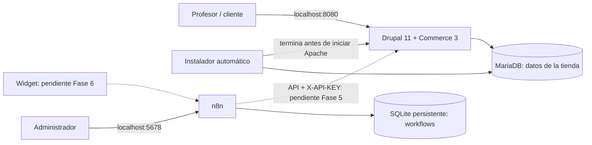

# BALTO Veterinaria

Proyecto académico de tienda virtual con Drupal Commerce, MariaDB y chatbot mediante n8n. Marca: **BALTO Veterinaria — Medicina para tu mascota**, Juliaca, Puno, Perú. Moneda: soles (PEN).

**Estado:** infraestructura de Fase 1 escrita; dependencias descargadas y verificaciones estáticas ejecutadas. El arranque completo de contenedores está **pendiente**: el entorno de desarrollo no tiene un motor Docker accesible. Todavía no existen tema, catálogo, checkout configurado, API ni chatbot.

## Arquitectura



MariaDB no publica puertos. Los servicios se comunican en una red Docker compartida. n8n usa su SQLite incorporado para evitar otro servicio de base de datos; los datos del negocio permanecen en MariaDB. Las líneas discontinuas son funcionalidades pendientes.

## Requisitos

- Docker Engine activo y Docker Compose v2 o superior. En Windows, Docker Desktop con WSL2.
- Git y Python 3 para preparar el repositorio y generar secretos.
- Conexión a internet para la primera construcción.
- Como objetivo de la demo, reservar al menos 4 GB de RAM para los servicios y espacio para imágenes y volúmenes.

No hace falta instalar PHP, Composer, Drupal ni MariaDB en la computadora del profesor.

## Preparar y levantar la demo

1. Abre una terminal en la carpeta del repositorio.
2. Comprueba el motor y Compose:

   ```bash
   docker info
   docker compose version
   ```

3. Genera `.env` una sola vez:

   ```bash
   python3 scripts/init-env.py
   ```

4. Levanta los servicios:

   ```bash
   docker compose up -d
   ```

5. Consulta el progreso de la primera instalación:

   ```bash
   docker compose logs -f drupal-init
   ```

6. Comprueba los servicios y ejecuta la verificación:

   ```bash
   docker compose ps -a
   bash scripts/verify.sh
   ```

7. Abre Drupal en <http://localhost:8080> y n8n en <http://localhost:5678>.

**Resultado esperado:** MariaDB, Drupal y n8n saludables; `drupal-init` finalizado con código 0; siete servicios, cinco categorías y una tienda en PEN cargados. La primera ejecución construye la imagen automáticamente y puede tardar varios minutos. El resultado esperado aún debe confirmarse con Docker activo.

Tras esta preparación, el comando de arranque diario es únicamente `docker compose up -d`. Para cambios del código PHP o dependencias, usa `docker compose up -d --build`.

## Acceder como administrador

1. Abre <http://localhost:8080/user/login>.
2. Usa el usuario `admin_balto` (o el valor de `DRUPAL_ADMIN_USER` en `.env`).
3. Consulta `DRUPAL_ADMIN_PASSWORD` en tu archivo `.env` local e introduce su valor.
4. Abre <http://localhost:8080/admin/commerce>.

**Resultado esperado:** acceso al panel de Commerce. El generador crea una contraseña distinta por instalación. No existe una contraseña pública compartida ni se guarda una contraseña real en este README.

En n8n, crea la cuenta propietaria desde la pantalla inicial. Se conserva en su volumen; la creación de esta cuenta no es necesaria para que Drupal arranque. El workflow se entregará e importará en Fase 6; la carpeta actual está reservada y no contiene un workflow ficticio.

## Datos reales y datos pendientes

| Dato | Valor |
| --- | --- |
| Nombre | BALTO Veterinaria |
| Lema | Medicina para tu mascota |
| Sede central | Jr. Ignacio Miranda N° 220, Juliaca |
| Segunda sede | Jr. Ignacio Miranda con Jr. Lima, Centro Comercial N° 3, Tienda N° 3 |
| WhatsApp | [986 866036](https://wa.me/51986866036) |
| Facebook | BALTO Veterinaria; enlace exacto pendiente |
| Correo del negocio | Pendiente; no se publica uno inventado |
| Hospitalización | 24 horas |
| Consultorio / tienda | **Ejemplo:** lunes a sábado de 09:00 a 19:00; pendiente de confirmar |
| Inventario | Productos y precios de ejemplo se incorporarán en Fase 3 |

La semilla guarda los siete servicios indicados por el negocio como contenido `Servicio`; guarda horarios, direcciones y contacto en configuración Drupal dentro de MariaDB. No confunde hospitalización continua con atención de consultorio continua. El correo `admin@example.invalid` es únicamente una dirección técnica de demostración.

La imagen recibida se usa como referencia visual. El logo original deberá colocarse en `drupal/web/themes/custom/vet_theme/images/logo.png` durante la fase del tema.

## Qué hace la instalación automática

1. Espera a que MariaDB esté sano y acepte las credenciales de Drupal.
2. Instala Drupal únicamente si la base está vacía; aborta si detecta una base no reconocible.
3. Habilita idioma, Commerce, carrito, checkout, pagos y Commerce Stock.
4. Crea la tienda en PEN y carga servicios, categorías y configuración del negocio.
5. Reconstruye cachés y permite que Apache inicie.

Los reinicios conservan los datos y no cambian la contraseña del administrador. La semilla tiene una marca de versión y no pisa cambios posteriores. No se habilita todavía la validación de existencias ni se configura el pago simulado: corresponden a Fases 3 y 4.

## Guardar los cambios con Git

El repositorio local se inicializa con commits pequeños por fase. GitHub necesita tu cuenta y un repositorio remoto; todavía no se ha publicado nada.

Para publicar cuando tengas un repositorio vacío, reemplaza el marcador por su URL real:

```bash
git remote add origin URL_REAL_DEL_REPOSITORIO
git push -u origin main
```

**Resultado esperado:** el código aparece en GitHub; `.env`, dependencias descargadas, bases de datos y backups quedan fuera del repositorio.

## Detener, reanudar y conservar datos

```bash
docker compose stop
docker compose up -d
```

**Resultado esperado:** la instalación y las cuentas permanecen. `docker compose down` también conserva los volúmenes. **No uses `docker compose down -v` para detener la demo: elimina las bases de datos y los archivos persistentes.** No cambies las claves de MariaDB o de cifrado de n8n sin planificar su rotación.

## Resolver problemas

| Síntoma | Causa posible | Qué hacer |
| --- | --- | --- |
| `permission denied` al usar Docker | Tu usuario no puede acceder al motor | Configura el acceso a Docker en tu sistema o usa una terminal autorizada |
| `Cannot connect to Docker daemon` / socket inexistente | Motor detenido o inaccesible | Inicia Docker Desktop o el servicio Docker antes de continuar |
| Falta una variable obligatoria | `.env` no preparado | Ejecuta `python3 scripts/init-env.py`; si ya existe, revisa sus claves |
| Puerto ocupado | Otra aplicación usa 8080 o 5678 | Cambia el puerto y sus URL relacionadas en `.env` |
| `drupal-init` termina con error | Instalación o dependencia falló | Consulta `docker compose logs drupal-init mariadb`; corrige la causa antes de reintentar |
| MariaDB rechaza credenciales tras editar `.env` | Las credenciales anteriores permanecen en el volumen | Restaura las variables originales o realiza una rotación administrada |
| Drupal devuelve HTTP 400 con otra dirección | Host no permitido | Añade el host a `DRUPAL_TRUSTED_HOSTS` y recrea los servicios |
| Drupal sigue mostrando interfaz del núcleo en inglés | Traducciones aún no incorporadas | La localización completa se configura en la fase del tema; los datos sembrados están en español |

## Fases y entregas

| Fase | Alcance | Estado |
| --- | --- | --- |
| 1 | Compose, dependencias, instalador y semilla inicial | Escrita; verificación de contenedores pendiente |
| 2 | Tema Twig, portada BALTO, servicios, horarios editables, mapa y WhatsApp | Pendiente de confirmación de Fase 1 |
| 3 | Quince productos de ejemplo, imágenes, catálogo, filtros y stock | Pendiente |
| 4 | Carrito, pago simulado, pedidos y roles | Pendiente |
| 5 | API protegida para n8n | Pendiente |
| 6 | Workflow por reglas y widget | Pendiente |
| 7 | Pruebas funcionales y móvil | Pendiente |
| 8 | Documentación, capturas y guion de cinco minutos | Pendiente |
| 9 | EC2, aprovisionamiento, backups y presupuesto AWS | Pendiente |

AWS queda dentro del alcance por tu ampliación del proyecto. No hay recursos creados ni consumo de créditos. La guía detallada y la tabla de costos se verificarán contra fuentes oficiales al trabajar Fase 9. No se usarán RDS, ALB ni NAT Gateway.

Consulta [las decisiones y pruebas de Fase 1](docs/fase-1.md) y [el contenido completo de los archivos de Fase 1](docs/fase-1-archivos.md).
