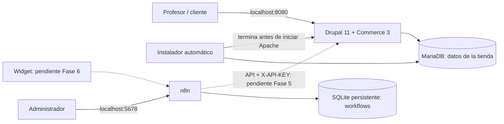

# Archivos completos de Fase 1

Este documento reúne el código escrito para esta fase. No incluye `.env` ni secretos reales. El archivo completo de versiones resueltas está en [composer.lock](../drupal/composer.lock). Las carpetas futuras contienen solo `.gitkeep`.


## `.dockerignore`

```text
.git
.env
.env.*
backups
docs
drupal/vendor
drupal/web/core
drupal/web/modules/contrib
drupal/web/themes/contrib
drupal/web/sites
**/*.log

```


## `.env.example`

```text
# Solo desarrollo local. Generar secretos con: python3 scripts/init-env.py
COMPOSE_PROJECT_NAME=balto
DRUPAL_PORT=8080
N8N_PORT=5678
BIND_ADDRESS=127.0.0.1
DRUPAL_BASE_URL=http://localhost:8080
DRUPAL_TRUSTED_HOSTS=localhost,127.0.0.1,drupal
DB_NAME=balto
DB_USER=balto
DB_PASSWORD=CAMBIAR
DB_ROOT_PASSWORD=CAMBIAR
DRUPAL_HASH_SALT=CAMBIAR
DRUPAL_ADMIN_USER=admin_balto
DRUPAL_ADMIN_PASSWORD=CAMBIAR
# Dirección técnica de demostración; NO es el correo del negocio.
DRUPAL_ADMIN_EMAIL=admin@example.invalid
VET_API_KEY=CAMBIAR
N8N_ENCRYPTION_KEY=CAMBIAR
N8N_HOST=localhost
N8N_PROTOCOL=http
N8N_SECURE_COOKIE=false
N8N_EDITOR_BASE_URL=http://localhost:5678
WEBHOOK_URL=http://localhost:5678/
CHAT_WEBHOOK_URL=http://localhost:5678/webhook/chat
CHAT_ALLOWED_ORIGIN=http://localhost:8080
TZ=America/Lima

```


## `.gitignore`

```text
.env
.env.*
!.env.example
/backups/
/drupal/vendor/
/drupal/web/core/
/drupal/web/modules/contrib/
/drupal/web/themes/contrib/
/drupal/web/profiles/contrib/
/drupal/web/sites/*/files/
/drupal/web/sites/*/settings*.php
/drupal/web/sites/*/services.yml
/drupal/web/autoload.php
/drupal/web/index.php
/drupal/web/update.php
/drupal/web/install.php
/drupal/web/robots.txt
/drupal/web/.htaccess
/drupal/web/example.gitignore
/drupal/web/INSTALL.txt
/drupal/web/README.md
/drupal/web/sites/default/default.*
/drupal/web/sites/development.services.yml
/drupal/web/sites/example.*
/drupal/web/profiles/README.txt
/drupal/web/modules/README.txt
/drupal/web/themes/README.txt
/drupal/.editorconfig
/drupal/.gitattributes
/drupal/recipes/README.txt
/drupal/web/.csslintrc
/drupal/web/.eslintignore
/drupal/web/.eslintrc.json
/drupal/web/.ht.router.php
/drupal/web/autoload_runtime.php
/drupal/web/sites/README.txt
*.log
.DS_Store

```


## `docker-compose.yml`

```yaml
name: ${COMPOSE_PROJECT_NAME:-balto}

x-drupal-environment: &drupal-environment
  DB_HOST: mariadb
  DB_PORT: '3306'
  DB_NAME: ${DB_NAME:-balto}
  DB_USER: ${DB_USER:-balto}
  DB_PASSWORD: ${DB_PASSWORD:?Genera .env con python3 scripts/init-env.py}
  DRUPAL_HASH_SALT: ${DRUPAL_HASH_SALT:?Falta DRUPAL_HASH_SALT}
  DRUPAL_BASE_URL: ${DRUPAL_BASE_URL:-http://localhost:8080}
  DRUPAL_TRUSTED_HOSTS: ${DRUPAL_TRUSTED_HOSTS:-localhost,127.0.0.1,drupal}
  VET_API_KEY: ${VET_API_KEY:?Falta VET_API_KEY}
  CHAT_WEBHOOK_URL: ${CHAT_WEBHOOK_URL:-http://localhost:5678/webhook/chat}
  CHAT_ALLOWED_ORIGIN: ${CHAT_ALLOWED_ORIGIN:-http://localhost:8080}
  TZ: ${TZ:-America/Lima}

services:
  mariadb:
    image: mariadb:11.4
    restart: unless-stopped
    environment:
      MARIADB_DATABASE: ${DB_NAME:-balto}
      MARIADB_USER: ${DB_USER:-balto}
      MARIADB_PASSWORD: ${DB_PASSWORD:?Falta DB_PASSWORD}
      MARIADB_ROOT_PASSWORD: ${DB_ROOT_PASSWORD:?Falta DB_ROOT_PASSWORD}
      TZ: ${TZ:-America/Lima}
    volumes:
      - mariadb_data:/var/lib/mysql
    networks: [backend]
    healthcheck:
      test: ['CMD', 'healthcheck.sh', '--connect', '--innodb_initialized']
      interval: 5s
      timeout: 5s
      retries: 30
      start_period: 30s
    logging: &logging
      driver: json-file
      options:
        max-size: '10m'
        max-file: '3'

  # Instalador de una ejecución: Apache arranca solo si termina correctamente.
  drupal-init:
    image: balto-drupal:local
    build:
      context: .
      dockerfile: drupal/Dockerfile
    restart: 'no'
    entrypoint: ['/bin/bash', '/opt/balto/scripts/install.sh']
    environment:
      <<: *drupal-environment
      DRUPAL_ADMIN_USER: ${DRUPAL_ADMIN_USER:-admin_balto}
      DRUPAL_ADMIN_PASSWORD: ${DRUPAL_ADMIN_PASSWORD:?Falta DRUPAL_ADMIN_PASSWORD}
      DRUPAL_ADMIN_EMAIL: ${DRUPAL_ADMIN_EMAIL:-admin@example.invalid}
    volumes:
      - drupal_files:/opt/drupal/web/sites/default/files
    networks: [backend]
    depends_on:
      mariadb:
        condition: service_healthy
    logging: *logging

  drupal:
    image: balto-drupal:local
    build:
      context: .
      dockerfile: drupal/Dockerfile
    restart: unless-stopped
    environment: *drupal-environment
    ports:
      - '${BIND_ADDRESS:-127.0.0.1}:${DRUPAL_PORT:-8080}:80'
    volumes:
      - drupal_files:/opt/drupal/web/sites/default/files
    networks: [backend]
    depends_on:
      mariadb:
        condition: service_healthy
      drupal-init:
        condition: service_completed_successfully
    healthcheck:
      test: ['CMD', 'php', '-r', 'exit(@file_get_contents("http://localhost/user/login") === false ? 1 : 0);']
      interval: 15s
      timeout: 10s
      retries: 15
      start_period: 60s
    logging: *logging

  n8n:
    image: docker.n8n.io/n8nio/n8n:2.47.4
    restart: unless-stopped
    ports:
      - '${BIND_ADDRESS:-127.0.0.1}:${N8N_PORT:-5678}:5678'
    environment:
      N8N_HOST: ${N8N_HOST:-localhost}
      N8N_PORT: '5678'
      N8N_PROTOCOL: ${N8N_PROTOCOL:-http}
      N8N_EDITOR_BASE_URL: ${N8N_EDITOR_BASE_URL:-http://localhost:5678}
      WEBHOOK_URL: ${WEBHOOK_URL:-http://localhost:5678/}
      N8N_SECURE_COOKIE: ${N8N_SECURE_COOKIE:-false}
      N8N_ENCRYPTION_KEY: ${N8N_ENCRYPTION_KEY:?Falta N8N_ENCRYPTION_KEY}
      N8N_ENFORCE_SETTINGS_FILE_PERMISSIONS: 'true'
      N8N_DIAGNOSTICS_ENABLED: 'false'
      N8N_PERSONALIZATION_ENABLED: 'false'
      N8N_DEFAULT_LOCALE: es
      GENERIC_TIMEZONE: ${TZ:-America/Lima}
      TZ: ${TZ:-America/Lima}
      EXECUTIONS_DATA_PRUNE: 'true'
      EXECUTIONS_DATA_MAX_AGE: '168'
      DRUPAL_INTERNAL_URL: http://drupal
      VET_API_KEY: ${VET_API_KEY:?Falta VET_API_KEY}
      CHAT_ALLOWED_ORIGIN: ${CHAT_ALLOWED_ORIGIN:-http://localhost:8080}
    volumes:
      - n8n_data:/home/node/.n8n
      - ./n8n/workflows:/workflows:ro
    networks: [backend]
    healthcheck:
      test: ['CMD', 'node', '-e', 'fetch("http://127.0.0.1:5678/healthz").then(r=>process.exit(r.ok?0:1)).catch(()=>process.exit(1))']
      interval: 15s
      timeout: 10s
      retries: 20
      start_period: 60s
    logging: *logging

volumes:
  mariadb_data:
  drupal_files:
  n8n_data:

networks:
  # Red bridge privada entre servicios; con salida para Composer y servicios futuros.
  # MariaDB no publica ningún puerto al equipo ni a internet.
  backend:
    driver: bridge

```


## `drupal/Dockerfile`

```text
# Imagen oficial; PHP 8.4 satisface Drupal 11 y Commerce 3.
FROM drupal:11.4.12-php8.4-apache-bookworm

USER root
RUN apt-get update \
    && apt-get install -y --no-install-recommends git unzip libicu-dev mariadb-client \
    && docker-php-ext-install intl bcmath \
    && rm -rf /var/lib/apt/lists/*

WORKDIR /opt/drupal
COPY drupal/composer.json drupal/composer.lock ./
RUN composer install --no-dev --prefer-dist --no-interaction --optimize-autoloader \
    && composer check-platform-reqs --no-dev

COPY drupal/web/modules/custom/ web/modules/custom/
COPY drupal/web/themes/custom/ web/themes/custom/
COPY drupal/config/ config/
COPY drupal/settings.php web/sites/default/settings.php
COPY scripts/ /opt/balto/scripts/
COPY drupal/php.ini /usr/local/etc/php/conf.d/balto.ini

# Solo los archivos subidos son modificables por el servidor web.
RUN mkdir -p web/sites/default/files \
    && chown -R www-data:www-data web/sites/default/files \
    && chmod 444 web/sites/default/settings.php \
    && chmod -R a+rX /opt/balto/scripts

EXPOSE 80
CMD ["apache2-foreground"]

```


## `drupal/composer.json`

```json
{
  "name": "balto/veterinaria",
  "description": "Tienda académica de BALTO Veterinaria con Drupal Commerce y n8n",
  "type": "project",
  "license": "GPL-2.0-or-later",
  "repositories": [{"type": "composer", "url": "https://packages.drupal.org/8"}],
  "require": {
    "composer/installers": "^2.3",
    "drupal/core-composer-scaffold": "11.4.12",
    "drupal/core-project-message": "11.4.12",
    "drupal/core-recommended": "11.4.12",
    "drupal/commerce": "^3.3",
    "drupal/commerce_stock": "^3.0",
    "drush/drush": "^13.0"
  },
  "conflict": {"drupal/drupal": "*"},
  "minimum-stability": "stable",
  "prefer-stable": true,
  "config": {
    "sort-packages": true,
    "platform": {"php": "8.4.0"},
    "allow-plugins": {
      "composer/installers": true,
      "drupal/core-composer-scaffold": true,
      "drupal/core-project-message": true,
      "symfony/runtime": true
    }
  },
  "extra": {
    "drupal-scaffold": {"locations": {"web-root": "web/"}},
    "installer-paths": {
      "web/core": ["type:drupal-core"],
      "web/libraries/{$name}": ["type:drupal-library"],
      "web/modules/contrib/{$name}": ["type:drupal-module"],
      "web/profiles/contrib/{$name}": ["type:drupal-profile"],
      "web/themes/contrib/{$name}": ["type:drupal-theme"]
    }
  }
}

```


## `drupal/php.ini`

```text
memory_limit=256M
upload_max_filesize=16M
post_max_size=20M
max_execution_time=120
date.timezone=America/Lima
expose_php=Off
display_errors=Off
log_errors=On

```


## `drupal/settings.php`

```php
<?php

/**
 * Configuración compartida por Drush y Apache. Los secretos vienen del entorno.
 */
$databases['default']['default'] = [
  'database' => getenv('DB_NAME'),
  'username' => getenv('DB_USER'),
  'password' => getenv('DB_PASSWORD'),
  'host' => getenv('DB_HOST') ?: 'mariadb',
  'port' => getenv('DB_PORT') ?: '3306',
  'driver' => 'mysql',
  'namespace' => 'Drupal\\mysql\\Driver\\Database\\mysql',
  'autoload' => 'core/modules/mysql/src/Driver/Database/mysql/',
  'prefix' => '',
];

$settings['hash_salt'] = getenv('DRUPAL_HASH_SALT');
$settings['config_sync_directory'] = '/opt/drupal/config/sync';
$settings['file_private_path'] = '/opt/drupal/private';
$settings['update_free_access'] = FALSE;
$settings['trusted_host_patterns'] = array_map(
  static fn(string $host): string => '^' . preg_quote(trim($host), '/') . '$',
  explode(',', getenv('DRUPAL_TRUSTED_HOSTS') ?: 'localhost,127.0.0.1,drupal'),
);

// No se exportan las claves a configuración ni se envían al navegador.
$settings['vet_api_key'] = getenv('VET_API_KEY');
$settings['vet_chat_webhook_url'] = getenv('CHAT_WEBHOOK_URL');
$settings['vet_chat_allowed_origin'] = getenv('CHAT_ALLOWED_ORIGIN');

```


## `scripts/init-env.py`

```python
#!/usr/bin/env python3
"""Genera credenciales locales aleatorias sin imprimirlas ni sobrescribir .env."""
from pathlib import Path
import os
import secrets

ROOT = Path(__file__).resolve().parents[1]
SECRET_KEYS = {
    'DB_PASSWORD', 'DB_ROOT_PASSWORD', 'DRUPAL_HASH_SALT',
    'DRUPAL_ADMIN_PASSWORD', 'VET_API_KEY', 'N8N_ENCRYPTION_KEY',
}


def main():
    target = ROOT / '.env'
    if target.exists():
        print('El archivo .env ya existe; se conserva sin cambios.')
        return
    lines = []
    for line in (ROOT / '.env.example').read_text().splitlines():
        key = line.partition('=')[0]
        lines.append(f'{key}={secrets.token_hex(32)}' if key in SECRET_KEYS else line)
    # O_EXCL evita sobrescrituras y 0600 restringe la lectura al propietario.
    fd = os.open(target, os.O_WRONLY | os.O_CREAT | os.O_EXCL, 0o600)
    with os.fdopen(fd, 'w') as output:
        output.write('\n'.join(lines) + '\n')
    print('Creado .env con secretos únicos. No lo subas a GitHub.')


if __name__ == '__main__':
    main()

```


## `scripts/install.sh`

```bash
#!/usr/bin/env bash
# Idempotente: los reinicios no reinstalan Drupal ni cambian contraseñas.
set -euo pipefail
cd /opt/drupal

for name in DB_PASSWORD DRUPAL_HASH_SALT DRUPAL_ADMIN_PASSWORD VET_API_KEY; do
  if [[ -z "${!name:-}" || "${!name}" == CAMBIAR ]]; then
    printf 'Falta configurar %s en .env.\n' "$name" >&2
    exit 1
  fi
done

# Espera explícita adicional, útil al ejecutar el script manualmente.
php /opt/balto/scripts/wait-db.php

# Se consulta la tabla de sistema: no se confunde un error de bootstrap con
# una base vacía, evitando reinstalar accidentalmente una tienda existente.
installed="$(php /opt/balto/scripts/is-installed.php)"
if [[ "$installed" == no ]]; then
  echo 'Instalando Drupal y creando el administrador de demostración…'
  drush site:install standard --yes \
    --site-name='BALTO Veterinaria' \
    --site-mail="$DRUPAL_ADMIN_EMAIL" \
    --account-name="$DRUPAL_ADMIN_USER" \
    --account-mail="$DRUPAL_ADMIN_EMAIL" \
    --account-pass="$DRUPAL_ADMIN_PASSWORD"
else
  echo 'Drupal ya está instalado; se conservan los datos existentes.'
fi

drush --yes en language commerce_product commerce_cart commerce_checkout commerce_payment \
  commerce_order commerce_store commerce_stock commerce_stock_local
drush php:script /opt/balto/scripts/seed.php
drush cache:rebuild
chown -R www-data:www-data /opt/drupal/web/sites/default/files
echo 'BALTO: instalación base terminada. Apache puede iniciar.'

```


## `scripts/is-installed.php`

```php
<?php

/** Una conexión fallida debe abortar; jamás habilitar una reinstalación. */
$connection = new PDO(
  sprintf('mysql:host=%s;port=%s;dbname=%s;charset=utf8mb4', getenv('DB_HOST'), getenv('DB_PORT') ?: '3306', getenv('DB_NAME')),
  getenv('DB_USER'),
  getenv('DB_PASSWORD'),
  [PDO::ATTR_ERRMODE => PDO::ERRMODE_EXCEPTION],
);
$tables = $connection->query('SHOW TABLES')->fetchAll(PDO::FETCH_COLUMN);
if (!$tables) {
  echo 'no';
}
elseif (in_array('config', $tables, TRUE) && in_array('key_value', $tables, TRUE)) {
  echo 'yes';
}
else {
  fwrite(STDERR, "Base no vacía sin instalación reconocible. Revisa manualmente; no se borrará nada.\n");
  exit(1);
}

```


## `scripts/wait-db.php`

```php
<?php

/** Espera hasta 120 segundos sin imprimir credenciales. */
for ($attempt = 0; $attempt < 60; $attempt++) {
  try {
    $connection = new PDO(
      sprintf('mysql:host=%s;port=%s;dbname=%s;charset=utf8mb4', getenv('DB_HOST'), getenv('DB_PORT') ?: '3306', getenv('DB_NAME')),
      getenv('DB_USER'),
      getenv('DB_PASSWORD'),
      [PDO::ATTR_ERRMODE => PDO::ERRMODE_EXCEPTION, PDO::ATTR_TIMEOUT => 2],
    );
    $connection->query('SELECT 1');
    exit(0);
  }
  catch (PDOException) {
    sleep(2);
  }
}
fwrite(STDERR, "MariaDB no respondió a tiempo. Revisa su healthcheck y las variables DB_.\n");
exit(1);

```


## `scripts/seed.php`

```php
<?php

/**
 * Semilla inicial idempotente. Ejecutar exclusivamente con drush php:script.
 * La marca de versión evita restaurar datos de ejemplo sobre ediciones reales.
 */
use Drupal\commerce_price\Entity\Currency;
use Drupal\commerce_store\Entity\Store;
use Drupal\node\Entity\Node;
use Drupal\node\Entity\NodeType;
use Drupal\taxonomy\Entity\Term;
use Drupal\taxonomy\Entity\Vocabulary;

$state = \Drupal::state();
if ($state->get('balto.seed.phase1.v1')) {
  echo "Los datos iniciales ya existen; se conservan los cambios del administrador.\n";
  return;
}

// Español forma parte del núcleo; las traducciones comunitarias se añaden luego.
if (!\Drupal::languageManager()->getLanguage('es')) {
  \Drupal\language\Entity\ConfigurableLanguage::createFromLangcode('es')->save();
}
\Drupal::configFactory()->getEditable('system.site')
  ->set('name', 'BALTO Veterinaria')
  ->set('slogan', 'Medicina para tu mascota')
  ->set('default_langcode', 'es')
  ->save();
\Drupal::configFactory()->getEditable('system.date')->set('timezone.default', 'America/Lima')->save();

if (!Currency::load('PEN')) {
  Currency::create([
    'currencyCode' => 'PEN',
    'name' => 'Sol peruano',
    'numericCode' => '604',
    'symbol' => 'S/',
    'fractionDigits' => 2,
  ])->save();
}

if (!Store::loadMultiple()) {
  Store::create([
    'type' => 'online',
    'uid' => 1,
    'name' => 'BALTO Veterinaria',
    // Correo técnico; no se presenta como contacto real del negocio.
    'mail' => getenv('DRUPAL_ADMIN_EMAIL') ?: 'admin@example.invalid',
    'default_currency' => 'PEN',
    'timezone' => 'America/Lima',
    'address' => [
      'country_code' => 'PE',
      'administrative_area' => 'PUN',
      'locality' => 'Juliaca',
      'address_line1' => 'Jr. Ignacio Miranda N° 220',
    ],
    'is_default' => TRUE,
  ])->save();
}

if (!NodeType::load('servicio')) {
  NodeType::create([
    'type' => 'servicio',
    'name' => 'Servicio',
    'description' => 'Servicios reales de BALTO Veterinaria.',
  ])->save();
  node_add_body_field(NodeType::load('servicio'));
}

$services = [
  'Medicina veterinaria en general' => 'Atención veterinaria general para tu mascota. Consulta por WhatsApp.',
  'Rayos X digital' => 'Servicio de diagnóstico mediante rayos X digital.',
  'Ecografías' => 'Servicio de ecografía veterinaria.',
  'Cirugías' => 'Servicio de cirugía veterinaria. Consulta la evaluación y disponibilidad por WhatsApp.',
  'Laboratorio' => 'Servicio de laboratorio veterinario.',
  'Internamiento' => 'Servicio de internamiento veterinario.',
  'Hospitalización veterinaria las 24 horas' => 'Hospitalización veterinaria disponible las 24 horas. Este horario no indica atención de tienda o consultorio las 24 horas.',
];
foreach ($services as $title => $body) {
  $existing = \Drupal::entityTypeManager()->getStorage('node')->loadByProperties([
    'type' => 'servicio', 'title' => $title,
  ]);
  if (!$existing) {
    Node::create([
      'type' => 'servicio', 'title' => $title, 'langcode' => 'es',
      'uid' => 1, 'status' => 1,
      'body' => ['value' => $body, 'format' => 'plain_text'],
    ])->save();
  }
}

if (!Vocabulary::load('categorias_productos')) {
  Vocabulary::create(['vid' => 'categorias_productos', 'name' => 'Categorías de productos'])->save();
}
foreach (['Alimentos', 'Accesorios', 'Higiene y cuidado', 'Juguetes', 'Salud/Medicamentos de venta libre'] as $name) {
  if (!\Drupal::entityTypeManager()->getStorage('taxonomy_term')->loadByProperties(['vid' => 'categorias_productos', 'name' => $name])) {
    Term::create(['vid' => 'categorias_productos', 'name' => $name, 'langcode' => 'es'])->save();
  }
}

// Configuración en MariaDB, consultable por la futura API y editable en Fase 2.
\Drupal::configFactory()->getEditable('vet_api.business')
  ->set('name', 'BALTO Veterinaria')
  ->set('slogan', 'Medicina para tu mascota')
  ->set('city', 'Juliaca, Puno, Perú')
  ->set('currency', 'PEN')
  ->set('addresses', [
    'Jr. Ignacio Miranda N° 220, Juliaca',
    'Jr. Ignacio Miranda con Jr. Lima, Centro Comercial N° 3, Tienda N° 3',
  ])
  ->set('whatsapp', '986 866036')
  ->set('whatsapp_url', 'https://wa.me/51986866036')
  ->set('facebook_name', 'BALTO Veterinaria')
  ->set('facebook_url', '')
  ->set('email', '')
  ->set('hospitalization', '24 horas')
  ->set('consultation_schedule', 'Horario de ejemplo: lunes a sábado de 09:00 a 19:00. Pendiente de confirmación por BALTO.')
  ->set('schedule_is_example', TRUE)
  ->set('catalog_is_example', TRUE)
  ->save();

$state->set('balto.seed.phase1.v1', TRUE);
echo "Cargados: tienda PEN, siete servicios, cinco categorías y datos de BALTO.\n";

```


## `scripts/verify.sh`

```bash
#!/usr/bin/env bash
# Comprobación de integración; requiere los contenedores iniciados.
set -euo pipefail
cd "$(dirname "$0")/.."

docker compose config --quiet
docker compose exec -T drupal drush status --fields=drupal-version,db-status,bootstrap
docker compose exec -T drupal drush php:script /opt/balto/scripts/verify-drupal.php
docker compose exec -T drupal php -r '
$url = "http://localhost/user/login";
if (@file_get_contents($url) === false) { fwrite(STDERR, "Drupal no responde.\n"); exit(1); }
echo "OK: página de acceso Drupal.\n";
'
docker compose exec -T n8n node -e '
fetch("http://127.0.0.1:5678/healthz").then(r=>{
  if(!r.ok) process.exit(1);
  console.log("OK: salud de n8n.");
}).catch(()=>process.exit(1));
'
echo 'Verificación de Fase 1 terminada correctamente.'

```


## `scripts/verify-drupal.php`

```php
<?php

/** Verifica resultados de instalación; falla si falta algún requisito base. */
$check = static function (bool $ok, string $message): void {
  if (!$ok) {
    throw new RuntimeException($message);
  }
  echo "OK: $message\n";
};
$modules = \Drupal::moduleHandler();
foreach (['commerce_product', 'commerce_cart', 'commerce_checkout', 'commerce_payment', 'commerce_stock', 'commerce_stock_local'] as $module) {
  $check($modules->moduleExists($module), "Módulo $module habilitado.");
}
$check(\Drupal::database()->driver() === 'mysql', 'Drupal usa MariaDB/MySQL.');
$check(\Drupal::config('system.site')->get('name') === 'BALTO Veterinaria', 'Nombre de la veterinaria.');
$check(\Drupal::config('system.site')->get('default_langcode') === 'es', 'Idioma español.');
$check((int) \Drupal::entityQuery('node')->condition('type', 'servicio')->accessCheck(FALSE)->count()->execute() === 7, 'Siete servicios cargados.');
$check((int) \Drupal::entityQuery('taxonomy_term')->condition('vid', 'categorias_productos')->accessCheck(FALSE)->count()->execute() === 5, 'Cinco categorías cargadas.');
$store = \Drupal\commerce_store\Entity\Store::loadMultiple();
$check(count($store) === 1 && reset($store)->getDefaultCurrencyCode() === 'PEN', 'Tienda de demostración en soles.');
$business = \Drupal::config('vet_api.business');
$check(count($business->get('addresses') ?? []) === 2, 'Dos sedes guardadas en configuración.');
$check($business->get('schedule_is_example') === TRUE, 'Horario del consultorio marcado como ejemplo.');
$check($business->get('email') === '', 'Correo real pendiente.');
$check(strlen(\Drupal\Core\Site\Settings::get('vet_api_key', '')) >= 32, 'API key presente en ajustes privados.');

```


## `README.md`

````markdown
# BALTO Veterinaria

Proyecto académico de tienda virtual con Drupal Commerce, MariaDB y chatbot mediante n8n. Marca: **BALTO Veterinaria — Medicina para tu mascota**, Juliaca, Puno, Perú. Moneda: soles (PEN).

**Estado:** infraestructura de Fase 1 escrita; dependencias descargadas y verificaciones estáticas ejecutadas. El arranque completo de contenedores está **pendiente**: el entorno de desarrollo no tiene un motor Docker accesible. Todavía no existen tema, catálogo, checkout configurado, API ni chatbot.

## Arquitectura



MariaDB no publica puertos. Los servicios se comunican en una red Docker compartida. n8n usa su SQLite incorporado para evitar otro servicio de base de datos; los datos del negocio permanecen en MariaDB. Las líneas discontinuas son funcionalidades pendientes.

## Requisitos

- Docker Engine activo y Docker Compose v2 o superior. En Windows, Docker Desktop con WSL2.
- Git y Python 3 para preparar el repositorio y generar secretos.
- Conexión a internet para la primera construcción.
- Como objetivo de la demo, reservar al menos 4 GB de RAM para los servicios y espacio para imágenes y volúmenes.

No hace falta instalar PHP, Composer, Drupal ni MariaDB en la computadora del profesor.

## Preparar y levantar la demo

1. Abre una terminal en la carpeta del repositorio.
2. Comprueba el motor y Compose:

   ```bash
   docker info
   docker compose version
   ```

3. Genera `.env` una sola vez:

   ```bash
   python3 scripts/init-env.py
   ```

4. Levanta los servicios:

   ```bash
   docker compose up -d
   ```

5. Consulta el progreso de la primera instalación:

   ```bash
   docker compose logs -f drupal-init
   ```

6. Comprueba los servicios y ejecuta la verificación:

   ```bash
   docker compose ps -a
   bash scripts/verify.sh
   ```

7. Abre Drupal en <http://localhost:8080> y n8n en <http://localhost:5678>.

**Resultado esperado:** MariaDB, Drupal y n8n saludables; `drupal-init` finalizado con código 0; siete servicios, cinco categorías y una tienda en PEN cargados. La primera ejecución construye la imagen automáticamente y puede tardar varios minutos. El resultado esperado aún debe confirmarse con Docker activo.

Tras esta preparación, el comando de arranque diario es únicamente `docker compose up -d`. Para cambios del código PHP o dependencias, usa `docker compose up -d --build`.

## Acceder como administrador

1. Abre <http://localhost:8080/user/login>.
2. Usa el usuario `admin_balto` (o el valor de `DRUPAL_ADMIN_USER` en `.env`).
3. Consulta `DRUPAL_ADMIN_PASSWORD` en tu archivo `.env` local e introduce su valor.
4. Abre <http://localhost:8080/admin/commerce>.

**Resultado esperado:** acceso al panel de Commerce. El generador crea una contraseña distinta por instalación. No existe una contraseña pública compartida ni se guarda una contraseña real en este README.

En n8n, crea la cuenta propietaria desde la pantalla inicial. Se conserva en su volumen; la creación de esta cuenta no es necesaria para que Drupal arranque. El workflow se entregará e importará en Fase 6; la carpeta actual está reservada y no contiene un workflow ficticio.

## Datos reales y datos pendientes

| Dato | Valor |
| --- | --- |
| Nombre | BALTO Veterinaria |
| Lema | Medicina para tu mascota |
| Sede central | Jr. Ignacio Miranda N° 220, Juliaca |
| Segunda sede | Jr. Ignacio Miranda con Jr. Lima, Centro Comercial N° 3, Tienda N° 3 |
| WhatsApp | [986 866036](https://wa.me/51986866036) |
| Facebook | BALTO Veterinaria; enlace exacto pendiente |
| Correo del negocio | Pendiente; no se publica uno inventado |
| Hospitalización | 24 horas |
| Consultorio / tienda | **Ejemplo:** lunes a sábado de 09:00 a 19:00; pendiente de confirmar |
| Inventario | Productos y precios de ejemplo se incorporarán en Fase 3 |

La semilla guarda los siete servicios indicados por el negocio como contenido `Servicio`; guarda horarios, direcciones y contacto en configuración Drupal dentro de MariaDB. No confunde hospitalización continua con atención de consultorio continua. El correo `admin@example.invalid` es únicamente una dirección técnica de demostración.

La imagen recibida se usa como referencia visual. El logo original deberá colocarse en `drupal/web/themes/custom/vet_theme/images/logo.png` durante la fase del tema.

## Qué hace la instalación automática

1. Espera a que MariaDB esté sano y acepte las credenciales de Drupal.
2. Instala Drupal únicamente si la base está vacía; aborta si detecta una base no reconocible.
3. Habilita idioma, Commerce, carrito, checkout, pagos y Commerce Stock.
4. Crea la tienda en PEN y carga servicios, categorías y configuración del negocio.
5. Reconstruye cachés y permite que Apache inicie.

Los reinicios conservan los datos y no cambian la contraseña del administrador. La semilla tiene una marca de versión y no pisa cambios posteriores. No se habilita todavía la validación de existencias ni se configura el pago simulado: corresponden a Fases 3 y 4.

## Guardar los cambios con Git

El repositorio local se inicializa con commits pequeños por fase. GitHub necesita tu cuenta y un repositorio remoto; todavía no se ha publicado nada.

Para publicar cuando tengas un repositorio vacío, reemplaza el marcador por su URL real:

```bash
git remote add origin URL_REAL_DEL_REPOSITORIO
git push -u origin main
```

**Resultado esperado:** el código aparece en GitHub; `.env`, dependencias descargadas, bases de datos y backups quedan fuera del repositorio.

## Detener, reanudar y conservar datos

```bash
docker compose stop
docker compose up -d
```

**Resultado esperado:** la instalación y las cuentas permanecen. `docker compose down` también conserva los volúmenes. **No uses `docker compose down -v` para detener la demo: elimina las bases de datos y los archivos persistentes.** No cambies las claves de MariaDB o de cifrado de n8n sin planificar su rotación.

## Resolver problemas

| Síntoma | Causa posible | Qué hacer |
| --- | --- | --- |
| `permission denied` al usar Docker | Tu usuario no puede acceder al motor | Configura el acceso a Docker en tu sistema o usa una terminal autorizada |
| `Cannot connect to Docker daemon` / socket inexistente | Motor detenido o inaccesible | Inicia Docker Desktop o el servicio Docker antes de continuar |
| Falta una variable obligatoria | `.env` no preparado | Ejecuta `python3 scripts/init-env.py`; si ya existe, revisa sus claves |
| Puerto ocupado | Otra aplicación usa 8080 o 5678 | Cambia el puerto y sus URL relacionadas en `.env` |
| `drupal-init` termina con error | Instalación o dependencia falló | Consulta `docker compose logs drupal-init mariadb`; corrige la causa antes de reintentar |
| MariaDB rechaza credenciales tras editar `.env` | Las credenciales anteriores permanecen en el volumen | Restaura las variables originales o realiza una rotación administrada |
| Drupal devuelve HTTP 400 con otra dirección | Host no permitido | Añade el host a `DRUPAL_TRUSTED_HOSTS` y recrea los servicios |
| Drupal sigue mostrando interfaz del núcleo en inglés | Traducciones aún no incorporadas | La localización completa se configura en la fase del tema; los datos sembrados están en español |

## Fases y entregas

| Fase | Alcance | Estado |
| --- | --- | --- |
| 1 | Compose, dependencias, instalador y semilla inicial | Escrita; verificación de contenedores pendiente |
| 2 | Tema Twig, portada BALTO, servicios, horarios editables, mapa y WhatsApp | Pendiente de confirmación de Fase 1 |
| 3 | Quince productos de ejemplo, imágenes, catálogo, filtros y stock | Pendiente |
| 4 | Carrito, pago simulado, pedidos y roles | Pendiente |
| 5 | API protegida para n8n | Pendiente |
| 6 | Workflow por reglas y widget | Pendiente |
| 7 | Pruebas funcionales y móvil | Pendiente |
| 8 | Documentación, capturas y guion de cinco minutos | Pendiente |
| 9 | EC2, aprovisionamiento, backups y presupuesto AWS | Pendiente |

AWS queda dentro del alcance por tu ampliación del proyecto. No hay recursos creados ni consumo de créditos. La guía detallada y la tabla de costos se verificarán contra fuentes oficiales al trabajar Fase 9. No se usarán RDS, ALB ni NAT Gateway.

Consulta [las decisiones y pruebas de Fase 1](docs/fase-1.md) y [el contenido completo de los archivos de Fase 1](docs/fase-1-archivos.md).

````


## `docs/fase-1.md`

````markdown
# Fase 1: infraestructura y preparación de Drupal

## Decisiones y compatibilidad

- Imagen oficial `drupal:11.4.12-php8.4-apache-bookworm`. Se comprobó que la etiqueta figura en el [registro oficial de Docker](https://github.com/docker-library/official-images/blob/master/library/drupal) y que la [receta oficial](https://github.com/docker-library/drupal/blob/master/11.4/php8.4/apache-bookworm/Dockerfile) incluye GD, PDO MySQL, ZIP, Composer, Apache y rewrite. Nuestro Dockerfile añade Intl, BCMath y cliente MariaDB para Drush.
- Drupal 11.4.12, Commerce 3.3.14, Commerce Stock 3.0.0 y Drush 13.8.1 quedaron resueltos en `drupal/composer.lock` mediante Composer. PHP objetivo: 8.4.0. [Commerce documenta compatibilidad con Drupal 11](https://docs.drupalcommerce.org/v2/installation/); [Commerce Stock 3.0.0 admite Drupal 10.2 y 11](https://www.drupal.org/project/commerce_stock/releases/3.0.0). Se verificaron además los archivos `.info.yml` descargados.
- Se mantienen restricciones exactas para el núcleo, alineadas con la imagen. Composer advierte sobre restricciones exactas; son intencionales para esta entrega. Las actualizaciones deberán cambiar imagen y dependencias juntas y repetir pruebas.
- MariaDB 11.4, sin puerto publicado, con volumen persistente y `healthcheck.sh` de su imagen. El nombre de servicio `mariadb` funciona como DNS dentro de Docker.
- n8n 2.47.4, versión estable indicada por la [documentación oficial consultada](https://docs.n8n.io/hosting/installation/docker/). Guarda sus workflows y usuarios en SQLite persistente; no necesita RDS ni otro contenedor de base de datos para esta demo. No se agrega un proveedor externo de IA.
- `drupal-init` es un contenedor auxiliar que termina. Reduce carreras entre solicitudes web e instalación y evita iniciar una tienda a medio instalar.
- Los puertos 8080 y 5678 se publican solo en `127.0.0.1` por defecto. La exposición pública, proxy, HTTPS y URLs públicas se resolverán en Fase 9.
- Se genera `.env` local con claves independientes y permisos `0600`; no hay credenciales reales en archivos versionados. La clave de API se guarda en ajustes de servidor, sin enviarla al navegador.

## Verificaciones ejecutadas

Ejecutadas en el entorno de trabajo:

- Descarga e instalación Composer de las 107 dependencias resueltas. En el PHP del equipo se omitieron exclusivamente los requisitos `ext-gd` y `ext-intl` para esa instalación; no se omiten en el Dockerfile. PHP local: 8.5; plataforma objetivo declarada: 8.4. Por ello esta instalación local no sustituye la prueba dentro del contenedor.
- Auditoría de Composer durante la resolución: sin avisos de vulnerabilidades conocidos.
- `docker compose config --quiet`: correcto con el `.env` generado.
- `bash -n scripts/install.sh scripts/verify.sh`: correcto.
- `php -l` en ajustes y scripts PHP: correcto.
- Generación de secretos sin imprimirlos y conservación del `.env` existente en una segunda ejecución.

## Límite de verificación

El motor Docker no está accesible: la comprobación inicial devolvió permiso denegado y la comprobación posterior con autorización devolvió socket inexistente. `sudo -n docker info` requiere contraseña. No se ejecutó con éxito una construcción ni un arranque de los contenedores.

También se exploró una base MariaDB temporal separada de cualquier proyecto; no sustituye una prueba de la imagen fijada. No se afirma haber instalado Drupal ni ejecutado su semilla en una base viva.

**Fase 1 todavía no está verificada de punta a punta.** No se pasa a Fase 2 hasta confirmar el arranque y recibir la confirmación solicitada por el usuario.

## Prueba pendiente con Docker activo

Desde la raíz del proyecto:

```bash
python3 scripts/init-env.py
docker compose up -d
docker compose logs -f drupal-init
docker compose ps -a
bash scripts/verify.sh
```

Resultado esperado: instalador con salida 0; los otros tres servicios saludables; comprobaciones de MariaDB, módulos Commerce, moneda, servicios, categorías, direcciones y claves correctas.

Para comprobar idempotencia:

```bash
docker compose run --rm drupal-init
bash scripts/verify.sh
docker compose restart drupal n8n mariadb
bash scripts/verify.sh
```

Tras reiniciar, espera a que MariaDB esté sano antes de repetir la verificación. Deben conservarse los siete servicios, cinco categorías y una sola tienda; no se debe cambiar la contraseña del administrador.

## Lo que se entregará después

La Fase 1 carga una semilla inicial de datos reales del negocio. Los quince productos, fotos y configuración de control de stock se implementarán en Fase 3; la pasarela simulada y roles en Fase 4. La API y el workflow no se sustituyen por archivos vacíos que pretendan estar operativos: sus carpetas están reservadas para Fases 5 y 6.

````
