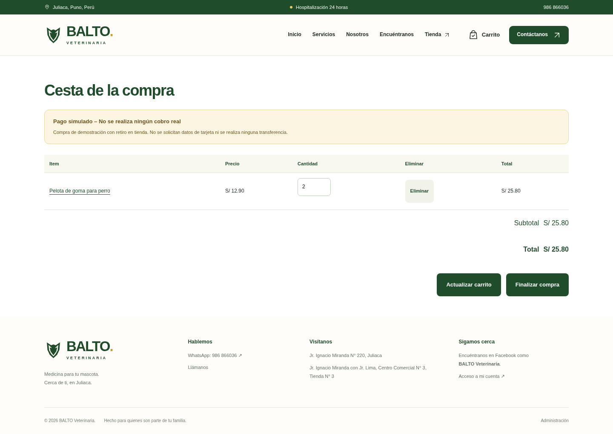
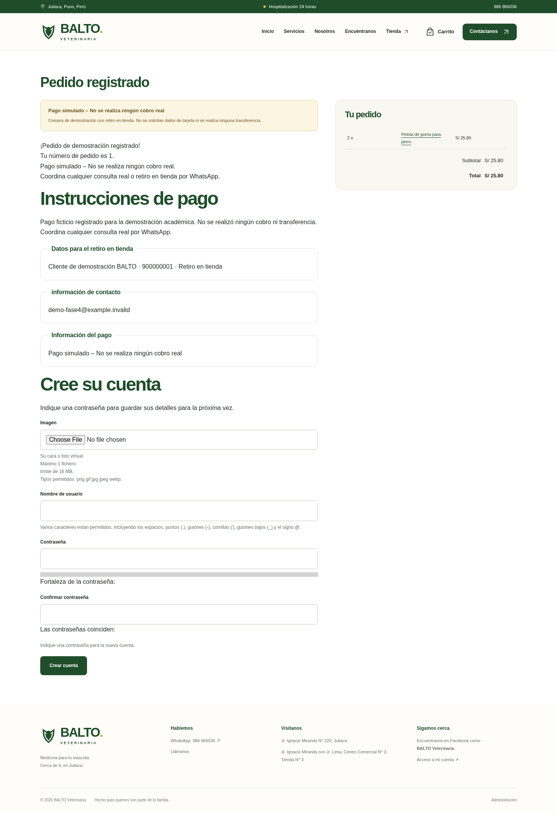
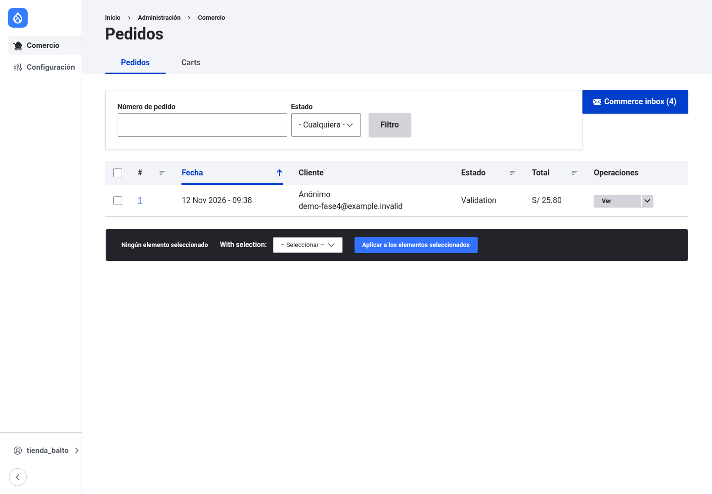

# Comprar y administrar pedidos de demostración

BALTO permite comprar como visitante o cliente, modificar el carrito y registrar un pedido con pago ficticio en soles. Esta fase usa el checkout y las entidades de Commerce; la pasarela manual propia registra únicamente una operación local de demostración. No solicita tarjetas ni contacta un proveedor de pagos. Los productos, precios y existencias siguen siendo ejemplos.

## Preparar las cuentas

En una instalación nueva se generan durante el arranque. Si actualizas desde la fase 3:

```bash
python3 scripts/init-env.py
docker compose up -d --build
```

El generador añade las variables que faltan y conserva los secretos existentes. Resultado esperado: el instalador termina correctamente y conserva los pedidos, precios y existencias anteriores.

| Perfil | Usuario predeterminado | Contraseña en el archivo local `.env` |
| --- | --- | --- |
| Administrador completo | `admin_balto` | `DRUPAL_ADMIN_PASSWORD` |
| Administrador de tienda | `tienda_balto` | `DRUPAL_STORE_MANAGER_PASSWORD` |
| Cliente | `cliente_balto` | `DRUPAL_CLIENT_PASSWORD` |

Los nombres también se pueden personalizar en `.env` antes de la primera instalación. No se publica una contraseña compartida. Inicia sesión en <http://localhost:8080/user/login>. Usa el administrador de tienda para demostrar la gestión habitual; su rol no permite administrar usuarios, módulos ni pasarelas.

## Registrar una compra de prueba

**Aviso:** confirmar el pedido descuenta existencias reales del inventario de demostración, aunque el pago sea ficticio. Usa datos de contacto de prueba.

1. Abre <http://localhost:8080/tienda> y elige un producto disponible.
2. Introduce una cantidad y pulsa **Agregar al carrito**.
3. Abre <http://localhost:8080/cart>.
4. Modifica la cantidad y pulsa **Actualizar carrito**, o elimina un producto si lo necesitas.
5. Pulsa **Finalizar compra**.
6. Completa nombre, teléfono peruano de nueve dígitos que empiece en 9 y correo; pulsa **Revisar pedido**.
7. Revisa el total y pulsa **Confirmar pedido simulado**.

Resultado esperado: aparece **¡Pedido de demostración registrado!**, con número de pedido y el aviso **Pago simulado – No se realiza ningún cobro real**. Se vacía el carrito y se descuenta el stock una sola vez. Puedes comprar sin crear una cuenta; el cliente autenticado también encuentra sus pedidos en su perfil.

La demo contempla retiro en tienda: no calcula envíos. No envía recibos por correo porque no se configuró SMTP. El estado de pago completado representa exclusivamente el pago ficticio.





## Revisar el pedido desde administración

1. Inicia sesión como administrador de tienda.
2. Abre <http://localhost:8080/admin/commerce/orders>.
3. Abre el número del pedido registrado.
4. Comprueba productos, cantidades, total en PEN y datos de contacto de prueba.

Resultado esperado: pedido en estado de validación y pago manual simulado registrado. La validación administrativa permite revisar la solicitud; no representa un cobro bancario. Otras sesiones no pueden abrir la confirmación privada de una compra ajena.



## Gestionar productos y existencias

1. Inicia sesión como administrador de tienda.
2. Abre <http://localhost:8080/admin/commerce/products>.
3. Abre la edición de un producto o el formulario para añadirlo.
4. Completa nombre, SKU único, descripción, fotografía con texto alternativo, categoría, especie y precio en PEN.
5. Ajusta las existencias mediante el campo de stock de la variación y guarda.

Resultado esperado: el catálogo muestra los datos guardados. El campo admite ajustes positivos y negativos; un ajuste negativo representa una reducción del saldo. El servidor rechaza ajustes que dejarían existencias negativas y compras superiores al stock disponible. La prueba de navegador comprobó acceso al formulario de creación y la edición de stock; no automatizó el alta completa de un producto nuevo en esta fase.

## Verificación realizada

El informe [verificacion-fase-4.json](verificacion-fase-4.json) registra **41 comprobaciones correctas**, sin errores JavaScript ni respuestas locales HTTP 500. Se ejecutaron con Drupal, Commerce Stock y MariaDB reales, usando navegadores independientes para visitante, cliente, administrador de tienda y sesión ajena.

- Compra completa como visitante y como cliente autenticado.
- Modificar cantidades, eliminar un segundo producto, recalcular total y vaciar carrito al finalizar.
- Validación del contacto, revisión y aviso de pago ficticio sin campos de tarjeta.
- Cada pedido con un único pago local completado y total correcto en PEN.
- Descuento exacto del stock; recargar la confirmación no duplica pago ni descuento.
- Consulta del pedido en administración y del historial del cliente.
- Denegación de accesos administrativos a clientes y de administración general al encargado de tienda.
- Rechazo del ajuste de stock negativo.
- Carrito y checkout en celular sin desbordamiento horizontal.

Las compras de prueba quedan visibles: pedidos 1 y 2, de dos y una unidades de la pelota para perro, respectivamente. El saldo pasó de 25 a 22. Las pruebas posteriores generan otros números y consumen stock; el informe conserva la evidencia de esta ejecución.

Para repetir las comprobaciones de configuración sin comprar:

```bash
bash scripts/verify.sh
```

Para repetir las compras automatizadas necesitas Deno, Puppeteer Core 25.10.0 y Brave o Chromium compatible. El script consulta `.env` local sin imprimir contraseñas:

```bash
BALTO_BROWSER=/ruta/al/navegador deno run --node-modules-dir=none --allow-all tests/phase4-browser.mjs
```

La protección de checkout usa bloqueos por pedido y variación y una transacción para revalidar saldo antes de registrar pago y pedido. Las pruebas verifican los flujos anteriores; todavía no se ha ejecutado una prueba de carga ni de compradores simultáneos. No se afirma protección demostrada frente a todos los escenarios de concurrencia.

## Resolver problemas

| Síntoma | Causa probable | Acción |
| --- | --- | --- |
| El carrito rechaza la cantidad | Stock insuficiente | Reduce la cantidad o elige otro producto |
| El formulario rechaza el teléfono | Formato no válido | Usa nueve dígitos y comienza por 9 |
| No puedes abrir pedidos administrativos | Cuenta de cliente | Inicia sesión como administrador de tienda |
| Faltan las cuentas al actualizar | Variables nuevas o imagen anterior | Ejecuta el generador y reconstruye los servicios |
| No llega un recibo | Correo desactivado en la demo | Consulta el pedido desde su confirmación o administración |

Fuentes de esta guía: configuración exportada, semillas y plugins propios, informe automatizado y capturas del navegador. Quedan pendientes la API pública protegida (fase 5), el chatbot (fase 6) y el despliegue AWS (fase 9).

La verificación de integración de las fases 1–4 terminó correctamente. También se ejecutó de nuevo el instalador sobre la base existente: conservó los dos pedidos completados, un pago por pedido y las 22 unidades de la pelota. Se revisaron 421 archivos de configuración exportada y no contenían los secretos locales de `.env`.

También se completó una instalación desde una base vacía en un proyecto Docker aislado y pasaron allí las verificaciones de configuración de las cuatro fases. Después se eliminaron solamente los volúmenes de ese proyecto temporal; la demo principal permanece disponible.
