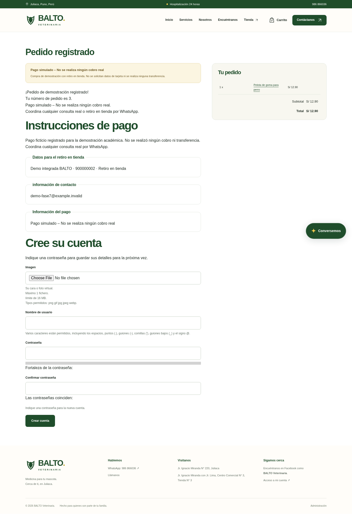
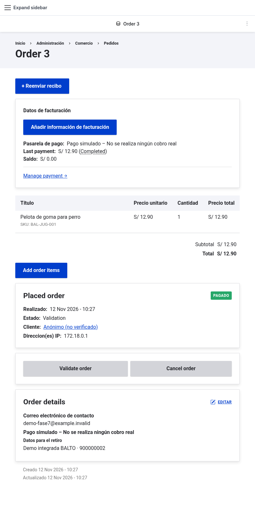
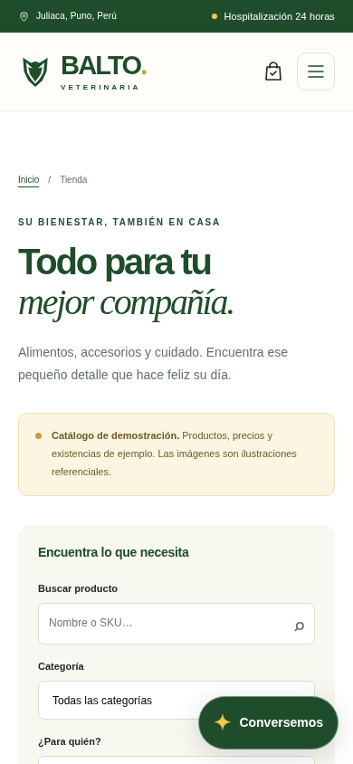

# Pruebas de la demo completa

Esta fase une los componentes ya comprobados en las fases anteriores. Se ejecuta un solo recorrido nuevo: consulta en el chat, compra desde el enlace del producto, pedido administrativo y datos actualizados en el chat. No se repiten todas las suites anteriores.

## Cobertura y evidencia

| Requisito | Evidencia ejecutada |
| --- | --- |
| Compra completa desde el chat hasta administración | [Informe integrado de fase 7](verificacion-fase-7.json) |
| Producto existente y precio | [Webhook, fase 6](verificacion-fase-6-chat.json) y recorrido integrado |
| Producto agotado | [Webhook, fase 6](verificacion-fase-6-chat.json), SKU `BAL-ALI-004` |
| Producto inexistente | [Webhook, fase 6](verificacion-fase-6-chat.json) |
| Categorías y productos por categoría | [Webhook, fase 6](verificacion-fase-6-chat.json) |
| Servicios, horarios, direcciones y contacto | [Webhook, fase 6](verificacion-fase-6-chat.json) |
| Mensaje sin sentido | [Webhook, fase 6](verificacion-fase-6-chat.json) |
| Stock descontado tras comprar y reflejado en chat | [Informe integrado de fase 7](verificacion-fase-7.json) |
| Precio editado en formulario administrativo y reflejado en chat | [Informe integrado de fase 7](verificacion-fase-7.json) |
| Carrito, checkout y chat en celular | [Checkout, fase 4](verificacion-fase-4.json), [widget, fase 6](verificacion-fase-6-widget.json) y captura integrada |
| Permisos de cliente, tienda y sesión ajena | [Checkout y roles, fase 4](verificacion-fase-4.json) |
| Protección de API y errores HTTP | [API, fase 5](verificacion-fase-5.json) |

Los informes anteriores conservan la fecha de su ejecución original. Esta matriz los reúne; no significa que todas esas pruebas se hayan vuelto a ejecutar en fase 7.

## Repetir el recorrido integrado

Requisitos: servicios Docker saludables, `.env` local con credenciales de tienda, Deno y Brave/Chromium. El producto `BAL-JUG-001` debe tener existencias suficientes. Las pruebas utilizan datos de contacto ficticios.

**Aviso previo:** se registra un pedido de pago simulado y se descuenta una unidad del inventario de demostración. El pedido permanece para revisarlo desde administración. Además, se incrementa temporalmente el precio de la pelota en S/ 0.50 y se restaura; evita editar simultáneamente ese producto.

1. Abre una terminal en el repositorio.
2. Inicia los servicios con `docker compose up -d`.
3. Ejecuta:

   ```bash
   deno run --node-modules-dir=none --allow-all tests/phase7-demo.mjs
   ```

4. Abre el [informe integrado](verificacion-fase-7.json).
5. Consulta el pedido desde <http://localhost:8080/admin/commerce/orders> con el usuario de tienda.

Resultado esperado: el informe no contiene errores; el pedido tiene un pago ficticio, total correcto en PEN y una unidad descontada. El chat muestra el nuevo saldo y refleja los cambios de precio guardados desde administración, sin reiniciar servicios.

Si usas otro navegador, configura `BALTO_BROWSER=/ruta/al/navegador`. La cuenta de tienda y su contraseña se leen de `.env` sin imprimirlas. El precio original se restaura incluso si falla una comprobación posterior a su edición.

## Evidencia visual del recorrido







La captura móvil muestra intencionalmente el precio temporal usado para comprobar la edición; al terminar la prueba vuelve al valor anterior. Los productos y existencias siguen siendo ejemplos, no inventario real del negocio.

## Límites de esta verificación

Se comprueba una compra secuencial en un entorno local con Drupal, MariaDB y n8n reales. No se ha ejecutado una prueba de carga ni de compradores simultáneos. La demo todavía no se ha probado en AWS; esa verificación corresponde al despliegue de fase 9. No existen cobros reales ni envío de recibos por correo.

Resultado de esta ejecución: **17 comprobaciones correctas** en 36 segundos. Pedido de demostración **3**, stock de la pelota de **22 a 21** y precio original restaurado. No se detectaron errores JavaScript ni respuestas Drupal HTTP 500.
