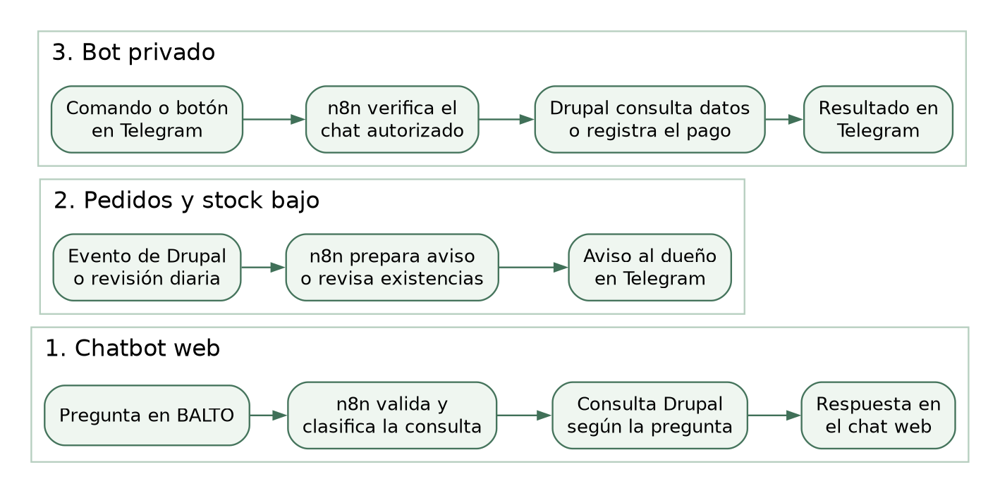

# Replicar BALTO desde otra laptop

Esta guía lleva desde un clon limpio hasta una tienda de prueba funcional. Para publicar una copia independiente, sigue después el recorrido de AWS. El repositorio trae el código y los datos de demostración. Los pedidos, las cuentas y la configuración de una instalación existente se trasladan mediante un respaldo autorizado.

## 1. Preparar la laptop

1. Instala Git, Python 3 y Docker con Compose v2. En Windows, usa Docker Desktop con WSL2 y ejecuta los comandos en Ubuntu. En macOS, usa la terminal con Docker Desktop abierto. En Linux, arranca Docker antes de continuar.
2. Comprueba que el motor y las herramientas respondan. Para seguir el despliegue de AWS, usa Compose 2.24.4 o superior.

   ```bash
   git --version
   python3 --version
   docker info
   docker compose version
   ```

3. Clona el repositorio y entra en su carpeta. Si GitHub solicita acceso, usa tu propia cuenta con permiso sobre el proyecto.

   ```bash
   git clone https://github.com/dimas-flores/balto-veterinaria.git
   cd balto-veterinaria
   git switch main
   git rev-parse --short HEAD
   ```

**Resultado esperado.** Estás en la rama `main` del proyecto y Docker responde sin errores. Guarda el identificador de Git si necesitas comparar tu copia con la de otro integrante.

## 2. Levantar la tienda local

1. Genera tu configuración y contraseñas con `python3 scripts/init-env.py`.
2. Ejecuta `docker compose up -d`.
3. Sigue la instalación con `docker compose logs -f drupal-init`. Pulsa **Ctrl+C** para salir de la vista de registros.
4. Ejecuta `docker compose ps -a` y comprueba que `drupal-init` haya terminado con código 0.
5. Ejecuta `bash scripts/verify.sh` y abre la [tienda local](http://localhost:8080).

**Resultado esperado.** La tienda, el catálogo y el chatbot están disponibles. Abre el [editor local de n8n](http://localhost:5678) y crea tu cuenta propietaria si es la primera vez. Para problemas de Docker, puertos o reconstrucción, consulta [Docker local](docker-local.md).

## 3. Entrar con el perfil adecuado

Abre el [inicio de sesión de Drupal](http://localhost:8080/user/login). Consulta los valores generados dentro de tu archivo privado `.env`.

| Perfil | Usuario y contraseña | Qué verificar |
|---|---|---|
| Administrador del sitio | `DRUPAL_ADMIN_USER` y `DRUPAL_ADMIN_PASSWORD` | Configuración de Drupal y datos del negocio. |
| Administrador de tienda | `DRUPAL_STORE_MANAGER_USER` y `DRUPAL_STORE_MANAGER_PASSWORD` | Productos y pedidos desde **Comercio**. |
| Cliente registrado | `DRUPAL_CLIENT_USER` y `DRUPAL_CLIENT_PASSWORD` | Catálogo, carrito y acceso a sus pedidos. |
| Visitante | Abre una ventana privada | Catálogo, chatbot y compra como invitado. |

## 4. Reproducir la demostración

1. Abre la portada y el catálogo en escritorio y en una vista móvil.
2. Abre el chatbot y consulta el precio y las existencias de Dog Chow Adulto 15 kg o de otro producto visible. Prueba también una pregunta sobre horarios.
3. Agrega un producto al carrito. Completa el checkout con datos ficticios y elige **Pagar al recoger en BALTO**. Verifica el número de pedido y el pago pendiente.
4. Repite con **Yape — coordinar primero por WhatsApp**. Verifica el enlace de coordinación. Para una prueba sin abono, conserva el estado pendiente.
5. Abre el pedido desde **Comercio → Pedidos** con el perfil de tienda y revisa importe y estado.

**Resultado esperado.** Puedes recorrer el flujo de cliente y el panel de pedidos. En local puedes mostrar el pago manual simulado cuando esté habilitado. Telegram requiere sus credenciales y un webhook HTTPS para recibir clics. Para confirmar pagos desde el bot usa únicamente un pedido de demostración que el equipo haya destinado a esa prueba.

## 5. Publicar una copia independiente en AWS

1. Prepara la cuenta de AWS o inicia el laboratorio autorizado. Revisa el presupuesto y crea la clave SSH y el grupo de seguridad según la [guía de AWS](aws-deploy.md).
2. Crea la instancia Ubuntu, asocia una **Elastic IP** propia y comprueba SSH con el usuario `ubuntu`.
3. Autoriza el acceso de la instancia al repositorio y ejecuta el [aprovisionamiento](aws-deploy.md#aprovisionar-y-levantar-la-tienda).
4. Configura tu dominio HTTPS o un nombre `sslip.io` que incluya tu propia IP. Sigue el [ejemplo de HTTPS](aws-deploy.md#nombre-gratuito-y-https-activos).
5. Abre la URL pública y comprueba portada, catálogo, carrito y chatbot. Consulta el [acceso al editor n8n mediante túnel SSH](aws-deploy.md#entrar-a-administración-y-n8n).

**Resultado esperado.** El sitio responde por HTTPS en tu URL. La IP elástica mantiene estable el enlace y las URLs de los webhooks al detener e iniciar la instancia. La copia publicada tiene sus propias credenciales y datos.

## 6. Activar y verificar integraciones de prueba

| Integración | Qué preparar | Prueba de aceptación |
|---|---|---|
| Telegram | Bot y chat autorizados, credenciales privadas en `.env`, HTTPS y registro seguro del webhook. Consulta [la configuración del webhook](aws-deploy.md#mercado-pago-checkout-pro-de-prueba). | Recibe el aviso de un pedido de prueba y revisa el botón de Yape. |
| Mercado Pago | Token del vendedor de prueba y ID del comprador de prueba. Sigue [Checkout Pro de prueba](aws-deploy.md#mercado-pago-checkout-pro-de-prueba). | Selecciona **Tarjeta (simulado)**, usa la cuenta compradora de prueba y vuelve a BALTO después de la aprobación. Comprueba el número público y el pago en Drupal. |
| Gemini | Clave propia si quieres habilitarlo. Consulta [el README](../README.md) y ejecuta el configurador de Gemini que trae el repositorio. | Comprueba una consulta del catálogo con la configuración elegida. El modo por reglas se puede probar sin clave. |

Usa integraciones de prueba y datos ficticios. Si Mercado Pago aprueba la operación y el navegador no vuelve a la confirmación, busca primero el estado en Drupal y sigue la [recuperación del pago aprobado](aws-deploy.md#mercado-pago-checkout-pro-de-prueba) antes de intentar otra compra.

## 7. Continuar el trabajo y preservar los datos

- **Actualizar código local.** Revisa `git status`, conserva tus cambios en tu rama, y en una copia limpia de `main` ejecuta `git pull --ff-only` y `docker compose up -d --build`.
- **Detener la demo.** Usa `docker compose stop`. `docker compose down -v` elimina los volúmenes. Para detener EC2 y conservar la publicación, sigue el [procedimiento de pausa y reanudación](aws-deploy.md#detener-reanudar-y-evitar-cargos-olvidados).
- **Trasladar datos existentes.** Sigue el [respaldo](aws-deploy.md#guardar-y-descargar-un-backup) y la [restauración en una instalación vacía](aws-deploy.md#recuperar-en-una-instalación-vacía). La restauración sobrescribe datos del destino. Mantén privados el respaldo, `.env`, las llaves SSH y las credenciales.
- **Actualizar AWS.** Guarda un respaldo antes de actualizar y anota el commit desplegado. Comprueba nuevamente HTTPS, checkout y chatbot.

## 8. Resolver problemas frecuentes

| Síntoma | Qué comprobar |
|---|---|
| Docker no responde | Abre Docker Desktop o arranca el motor de Docker y vuelve a ejecutar `docker info`. |
| La tienda tarda en abrir | Revisa `docker compose ps -a` y `docker compose logs drupal-init mariadb`. |
| El puerto local está ocupado | Confirma qué proceso lo ocupa y revisa los puertos y URLs de `.env.example` y [Docker local](docker-local.md). |
| La web abre, pero SSH expira | Comprueba la IP pública de origen y la regla SSH del grupo de seguridad. |
| No llega Telegram | Verifica que el workflow y las credenciales correspondan a tu bot y que la URL pública del webhook apunte a tu despliegue. |

## 9. Entender y reproducir los flujos de n8n



**Por qué se eligió n8n.** Permite ver cada paso de la automatización, reutilizar credenciales y revisar dónde falla una ejecución. El equipo puede versionar los flujos como JSON y publicarlos al levantar Compose. Drupal sigue siendo la fuente del catálogo, las existencias y el estado de cada pedido.

| Flujo | Entrada | Resultado |
|---|---|---|
| [Chatbot](../n8n/workflows/chatbot.json) | Una pregunta desde el widget de BALTO | n8n valida y clasifica el mensaje, consulta Drupal cuando corresponde y devuelve la respuesta al widget. Gemini se puede habilitar para interpretar o redactar consultas. |
| [Avisos de pedidos](../n8n/workflows/pedidos.json) | Un evento de Drupal o la revisión diaria programada | n8n avisa al dueño por Telegram de los pedidos, pagos o existencias bajas. |
| [Bot de Telegram](../n8n/workflows/bot.json) | Un comando o clic del dueño | n8n verifica el chat autorizado, consulta Drupal o solicita el registro del pago, y devuelve el resultado a Telegram. |

### Probar primero el chat local

1. Ejecuta `docker compose up -d` y revisa `docker compose logs --tail=80 n8n`. El arranque importa y publica el chatbot.
2. Abre [BALTO local](http://localhost:8080) y pregunta por un producto o por los horarios. Para revisar los nodos, entra al [editor de n8n](http://localhost:5678) y abre el workflow BALTO.
3. Si cambiaste el puerto o el dominio, revisa las variables en [Configurar las URL](fase-6.md#configurar-las-url). Después ejecuta `docker compose up -d` para aplicar la configuración.

**Resultado esperado.** El chat responde desde la tienda. El acceso al editor es independiente del webhook que usa el visitante.

### Probar Telegram en tu despliegue HTTPS

1. Usa un bot exclusivo para tu prueba. Configura en el `.env` privado `TELEGRAM_BOT_TOKEN`, `TELEGRAM_CHAT_ID` y `BALTO_N8N_SECRET` con un valor aleatorio de al menos 32 caracteres. El aviso diario usa `STOCK_ALERT_THRESHOLD`, con 5 como valor predeterminado.
2. Ajusta `WEBHOOK_URL` al origen HTTPS público y configura `BALTO_TELEGRAM_WEBHOOK_SECRET`. Sigue el [registro seguro del webhook](aws-deploy.md#mercado-pago-checkout-pro-de-prueba). Registra `message` y `callback_query` en `/webhook/balto-bot-webhook/webhook`.
3. Ejecuta `sudo docker compose up -d` desde la carpeta del proyecto en EC2. Comprueba que el bot y los avisos se publiquen al arrancar y conserva el editor detrás del túnel SSH.
4. Desde el chat autorizado prueba `/stock` y `/pedidos`. Crea un pedido por Yape con datos ficticios y verifica que aparezca **Confirmar pago**. Para verificar el botón, utiliza un pedido dedicado a la prueba y comprueba el estado final en Drupal.

**Resultado esperado.** Llegan los avisos al chat autorizado y el botón de Yape registra el cambio en Drupal. Caddy recibe el webhook público y n8n accede a Drupal por la red interna.

Para cambiar un flujo, guarda primero las modificaciones que hiciste en el editor. El arranque puede reemplazar el flujo administrado al detectar un JSON actualizado. Versiona los cambios en `n8n/workflows/` y prueba la importación en tu copia local. Para las reglas del chatbot, consulta [la guía del flujo](fase-6.md#recorrido-de-una-consulta). El [fuente del diagrama](diagramas/flujo-n8n.dot) permite regenerar la imagen con Graphviz.
